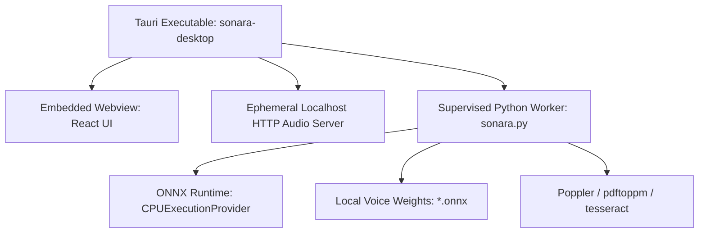

# Sonara — Packaging, Distribution, and Bundling Guide

This document describes the deployment, runtime bundling, and packaging strategy for Sonara across Linux, macOS, and Windows, conforming to Phase 8 of `docs/ROADMAP.md`.

---

## 1. Distribution Architecture Overview

Sonara is built as a hybrid desktop application:
1. **Frontend**: React 19 + TypeScript + Vite compiled into static web assets (`ui-react/dist`).
2. **Desktop Shell**: Tauri 2.10.3 Rust core managing OS windows, secure loopback HTTP audio serving, native file dialogs, process lifecycle, and progress persistence.
3. **Synthesis Engine**: Supervised local Python worker executing Piper ONNX CPU inference and Poppler extraction.



---

## 2. Desktop Packaging Modes

### A. Developer & Portable Mode (Current)
- `src-tauri/tauri.conf.json` has `"bundle": { "active": false }`.
- Tauri binary links against local system libraries (`libgtk-3`, `libwebkit2gtk-4.1`).
- Python interpreter is discovered via:
  1. `SONARA_PYTHON` environment variable, or
  2. `<repo_root>/.venv/bin/python`.
- Voice weights are located in `models/piper/` or configured via `SONARA_MODEL_DIR`.
- Ideal for fast development, headless testing, and developer builds.

### B. Self-Contained Desktop Installer (Production Target)
For end users who do not have Python or Rust installed:

1. **Embedded Python Runtime**:
   - Use `PyInstaller` or `python-build-standalone` (Astral / Gregory Szorc) to package a frozen, self-contained Python directory containing `piper-tts`, `onnxruntime`, and standard libraries.
   - Bundle as Tauri external binaries/resources in `src-tauri/tauri.conf.json`:
     ```json
     "bundle": {
       "active": true,
       "targets": ["deb", "appimage"],
       "resources": [
         "../models/piper/en_US-john-medium.*",
         "../bin/sonara-engine/**"
       ]
     }
     ```
2. **Target Formats**:
   - **Linux**: Debian package (`.deb`) and standalone `AppImage`. Requires system WebKitGTK 4.1.
   - **macOS**: Universal `.dmg` with signed `.app` bundle. Uses native WebKit WKWebView.
   - **Windows**: NSIS installer (`.exe`) or `.msi`. Uses system Microsoft Edge WebView2.

---

## 3. Dependency Licensing & Redistribution Audit

Before distributing bundled binaries:

| Component | License | Bundling & Redistribution Terms |
|---|---|---|
| **Sonara Core & UI** | MIT | Permissive, freely redistributable. |
| **Tauri 2 & Rust Crates** | MIT / Apache 2.0 | Permissive; include copyright notices. |
| **React 19, TypeScript, Vite** | MIT | Permissive; bundled into static assets. |
| **Piper TTS Runtime** | GPL-3.0-or-later | Must comply with GPL-3.0 terms if distributed as a combined binary. Isolating Piper in a separate child process (as Sonara currently does) preserves clear architectural and licensing separation. |
| **ONNX Runtime** | MIT | Permissive; include Microsoft ONNX Runtime notice. |
| **Piper Voices (John / Bryce / Ryan)** | Public Domain / LibriVox / ODC-By | Review upstream model card notices; John model audio originates from public domain LibriVox recordings. |
| **Poppler utilities (`pdftotext`, `pdftoppm`)** | GPL-2.0-or-later | Subprocess invocation avoids linking issues; declare system dependency in `.deb` package `Depends: poppler-utils`. |
| **Tesseract OCR (optional)** | Apache 2.0 | Optional external dependency for scanned documents; declare in `.deb` `Recommends: tesseract-ocr`. |

---

## 4. Building the Production Desktop Binary

### Step 1: Build the Optimized Frontend Bundle
```bash
npm run build --prefix ui-react
```

### Step 2: Build the Tauri Executable
```bash
cargo build --manifest-path src-tauri/Cargo.toml --release --locked --offline
```
The resulting binary is created at `src-tauri/target/release/sonara-desktop`.

### Step 3: Run Validation & Integrity Checks
```bash
cargo test --manifest-path src-tauri/Cargo.toml --locked --offline
npm test --prefix ui-react
.venv/bin/python -m unittest discover -s tests
```
